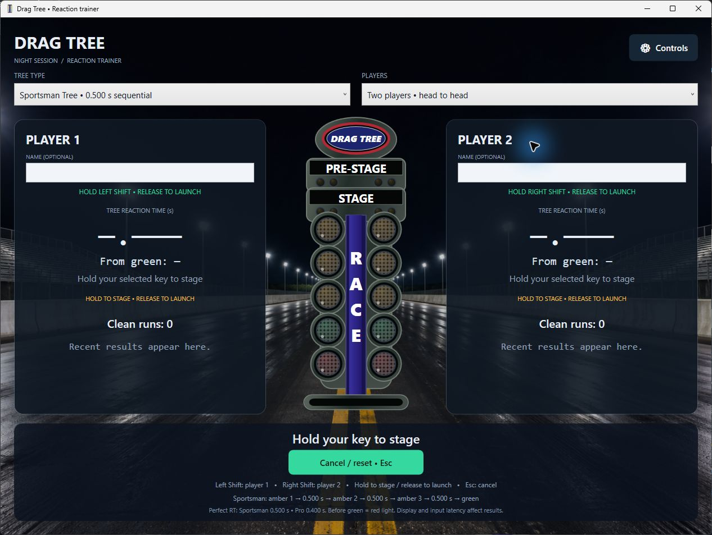

# Drag Tree



WPF reaction trainer for Windows and .NET 10. Run `dotnet run --project DragTree.csproj`.

Choose Sportsman or Pro, then single-player or two-player mode. Optional racer names appear in result messages. Press Enter or click outside a name box after editing.

## Controls

Use the **gear / Controls** button to choose each racer's key. Shift, Ctrl, Space, letters, digits, numpad digits, and arrows are available. Choose different keys for each racer. **Save controls** applies and stores preferences in `%LOCALAPPDATA%/DragTree/keys.json`; **Restore Shift defaults** selects Left Shift and Right Shift. Escape is reserved for cancellation. Keys cannot change while racers are staged.

- Hold the selected key: pre-stage lights turn on immediately. Keep holding for one second to light that lane's stage bulbs.
- After every active racer fully stages, a random 1.2–3.0-second delay precedes the first amber.
- Release the key to launch. Releasing while still waiting for full staging simply unstages that lane. Releasing during the countdown before green produces a red light.
- Escape or Cancel / reset cancels a race. Focus loss also cancels and clears held keys.

Windows Raw Input handles each configured key's press and release independently, including either Shift-release order. WPF is the fallback when registration fails. Typing in name fields or choosing keys in Controls does not stage a racer.

## Timing and results

Sportsman: top amber at 0 ms, second at 500 ms, third at 1000 ms, green at 1500 ms. Each amber goes out as the next illuminates. Pro: all ambers together, then green 400 ms later. These countdowns follow the [NHRA glossary](https://nhra.com/nhra-101/nhra-glossary). The one-second pre-stage hold is a simulator setting.

The large **tree reaction time** starts at the final amber: 0.500 seconds is ideal for Sportsman; 0.400 is ideal for Pro. The smaller **From green** value shows the same release relative to green, where 0.000 is ideal. For example, 0.032 seconds after green is tree RT 0.532 for Sportsman or 0.432 for Pro. Any unrounded negative difference from green is a red light. Sub-millisecond early releases display -<0.001, so they cannot appear to be legal zeroes. Actual track timing measures the tire clearing the staging beam; this app measures key release.

Each racer has recent results and clean-run statistics. Best and average are labeled **from green**, so results across tree types remain comparable. No delta symbols are used. A two-player winner banner shows the fastest clean launch and racer name for three seconds; equal displayed clean times show a tie. No clean launches means no winner. Unfinished racers time out five seconds after green. Starting another race or resetting dismisses the banner. Results and names remain in memory for the session.

An absolute monotonic stopwatch schedule prevents delays accumulating between bulbs. Monitor refresh, UI rendering, scheduling, and input latency still affect the practice measurements.

## Night theme

`Assets/night-dragstrip.png` is an embedded background showing a floodlit drag strip with reflective asphalt. It contains no starting tree; the app's functional tree is drawn separately. The background was generated using the built-in ImageGen tool. Its exact prompt is saved in `Assets/night-dragstrip.prompt.txt`.

## Build and checks

```powershell
dotnet build DragTree.csproj -c Release
dotnet run --project tests/DragTree.Checks.csproj -c Release
```

The executable is in `bin/Release/net10.0-windows/`.

## Installer and releases

See [installer/README.md](installer/README.md) for the self-contained Windows installer, portable ZIP, checksums, and GitHub release workflow.

In two-player mode, when one racer is fully staged and the other has not pre-staged, an amber warning appears on the waiting racer's panel with their name and configured key. It clears when they pre-stage, the opponent unstages, or the race is canceled.
